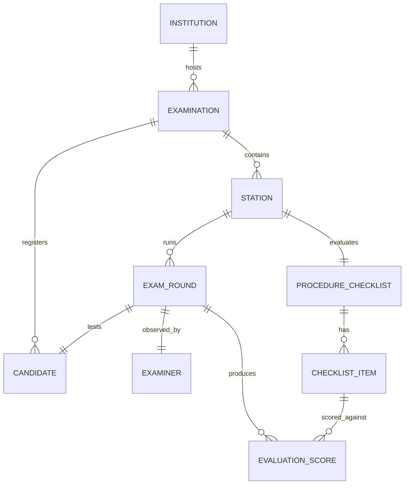

# Digital OSCE Platform for B.Sc. Nursing
## Comprehensive System Specification & Clinical Examination Blueprint
*Aligned with Indian Nursing Council (INC) Revised Competency-Based Regulations, WHO Guidelines, and National Health Standards (Mission Niramaya / TNNMC / AIIMS)*

---

## Executive Summary

The **Digital OSCE (Objective Structured Clinical Examination) Platform** is an enterprise-grade medical assessment system designed specifically for Nursing Colleges and Universities. It transforms traditional, paper-heavy, slow, and error-prone nursing practical examinations into a synchronized, paperless, real-time clinical assessment engine.

This document serves as the foundational **Architectural, Clinical, and Technical Blueprint** before application development. It covers:
1. **Academic Framework**: Complete mapping of B.Sc. Nursing (8-Semester Competency-Based Curriculum) under INC guidelines.
2. **Clinical Procedure Repository**: Exhaustive inventory of nursing procedures tested in OSCE stations across all major nursing specialties.
3. **Standardized Checklist Rubrics**: INC/WHO-compliant step-by-step evaluation rubrics with objective scoring scales.
4. **Platform Architecture & Station Engine**: Technical specifications for the Station Builder, Digital Bell, Dynamic Queue Engine, and Absentee Handling.
5. **Examiner & Admin Experience**: Touch-first mobile/tablet interface for examiners and real-time live cockpit for exam administrators.
6. **Analytics & One-Click Multi-Format Export**: Automated gradebook calculation, Excel/CSV generation, and quality analytics (station difficulty & discrimination index).

---

## 1. Academic Curriculum & Practical Examination Structure

### 1.1 The INC Semester System (Revised Regulations)
The Indian Nursing Council (INC) transitioned the 4-year B.Sc. Nursing degree into an **8-Semester Competency-Based Curriculum**. Practical competencies are evaluated through:
*   **Continuous Internal Assessment (CIA)**: Formative OSCEs, clinical logbook entries, procedures re-demonstrations, and clinical evaluations (Weightage: 50%).
*   **End-Semester University Practical Examination**: Summative OSCEs, bedside clinical examination, and viva-voce conducted jointly by Internal and External Examiners (Weightage: 50%).
*   **Minimum Passing Standard**: A student must secure **at least 50% marks** separately in theory and practicals.

### 1.2 Semester-Wise Subject & Practical Examination Breakdown

| Semester | Core Theory Subjects | Practical / Clinical Subject | Practical Exam Type | Credits / Practical Hours |
| :--- | :--- | :--- | :--- | :--- |
| **Semester I** | Communicative English, Applied Anatomy, Applied Physiology, Applied Sociology, Applied Psychology | **Nursing Foundation I** | Skill Lab Evaluation (Formative OSCE) | 160 Hours (Skill Lab) |
| **Semester II** | Applied Biochemistry, Applied Nutrition & Dietetics, Health/Nursing Informatics & Technology | **Nursing Foundation II** (incl. First Aid Module) | **University Practical Exam** (Nursing Foundation I & II - 100 Marks) | 480 Hours (Clinical + Lab) |
| **Semester III** | Applied Microbiology & Infection Control, Pharmacology I, Pathology I | **Adult Health Nursing I** (Medical-Surgical Nursing I) | **University Practical Exam** (Adult Health Nursing I - 100 Marks) | 480 Hours (Clinical) |
| **Semester IV** | Pharmacology II, Pathology II & Genetics, Professionalism & Ethics | **Adult Health Nursing II** (Medical-Surgical Nursing II) | **University Practical Exam** (Adult Health Nursing II - 100 Marks) | 560 Hours (Clinical) |
| **Semester V** | Child Health Nursing I, Mental Health Nursing I, Community Health Nursing I, Educational Technology, Forensic Nursing | **Clinical Postings**: Child Health, Mental Health, Community Health | Mid-term Skill Stations & Formative OSCE | 480 Hours (Clinical) |
| **Semester VI** | Child Health Nursing II, Mental Health Nursing II, Nursing Management & Leadership, Midwifery I | **Child Health Nursing (I & II)**<br>**Mental Health Nursing (I & II)** | **Two University Practical Exams** (100 Marks Each) | 480 Hours (Clinical) |
| **Semester VII** | Community Health Nursing II, Midwifery II | **Community Health Nursing (I & II)**<br>**Midwifery & OBG Nursing (I & II)** | **Two University Practical Exams** (100 Marks Each) | 780 Hours (Clinical) |
| **Semester VIII** | Internship / Clinical Residency (22 Weeks) | **Integrated Clinical Practice** (Adult, Child, Mental, Community, Midwifery) | **Comprehensive Exit OSCE / Practical Assessment** | 1056 Hours (Intensive Residency) |

---

## 2. Clinical Procedure Repository for OSCE Stations

OSCE stations evaluate three primary domains of learning:
1. **Psychomotor Skills**: Hands-on execution of physical nursing procedures.
2. **Cognitive / Analytical Skills**: Interpretation of diagnostic reports, ECGs, drug dosage calculations, fluid balances, and growth charts.
3. **Affective / Communication Skills**: Patient counseling, consent taking, empathetic communication, and health teaching.

Below is the standard inventory of clinical procedures assessed via OSCE stations across the 6 core nursing domains:

```
┌─────────────────────────────────────────────────────────────────────────────┐
│                       B.SC. NURSING OSCE CLINICAL DOMAINS                   │
├─────────────────┬─────────────────┬─────────────────┬───────────────────────┤
│ 1. Foundations  │ 2. Adult Health │ 3. Child Health │ 4. Mental Health      │
│  (Sem I & II)   │  (Sem III & IV) │  (Sem V & VI)   │   (Sem V & VI)        │
├─────────────────┴─────────────────┴─────────────────┴───────────────────────┤
│ 5. Community Health Nursing       │ 6. Midwifery & Obstetrical Nursing      │
│  (Sem V & VII)                    │   (Sem VI & VII)                        │
└─────────────────────────────────────────────────────────────────────────────┘
```

### 2.1 Nursing Foundations (Semesters I & II)
*   **NF-01: Vital Signs Assessment**:
    *   Oral & Axillary Digital Temperature measurement
    *   Radial pulse rate, rhythm, and volume assessment
    *   Respiratory rate and pattern assessment
    *   Non-invasive Blood Pressure (Auscultatory method with aneroid/mercury sphygmomanometer)
    *   Pulse oximetry ($SpO_2$) and interpretation of plethysmograph wave
*   **NF-02: Infection Prevention & Asepsis (WHO Standards)**:
    *   WHO 6-step hand hygiene technique (Soap & water vs. Alcohol rub)
    *   Surgical hand scrubbing
    *   Personal Protective Equipment (PPE): Systematic Donning and Doffing sequence
    *   Biomedical Waste (BMW) Management segregation at point of generation
*   **NF-03: Medication Administration**:
    *   Oral medication administration with 10 Rights of Medication
    *   Intramuscular (IM) injection (Ventrogluteal, Vastus Lateralis, Deltoid techniques)
    *   Subcutaneous (SC) injection (Insulin pen / syringe, Heparin administration)
    *   Intradermal (ID) injection (Mantoux test / Drug sensitivity test)
    *   Peripheral Intravenous (IV) cannulation and priming IV infusion set
    *   IV push medication via three-way stopcock or saline lock
*   **NF-04: Respiratory & Airway Procedures**:
    *   Oxygen therapy via nasal prongs, simple face mask, and Venturi mask
    *   Steam inhalation and ultrasonic nebulization therapy
    *   Oropharyngeal and nasopharyngeal suctioning
    *   Tracheostomy suctioning and stoma dressing
*   **NF-05: Gastrointestinal & Urinary Procedures**:
    *   Nasogastric (NG / Ryle's) tube insertion, placement verification, and bolus feeding
    *   Urinary catheterization (Male and Female Foley Catheter insertion with strict aseptic technique)
    *   Urinary catheter care and safe removal
    *   Evacuant (cleansing) and retention enema administration
*   **NF-06: Basic Nursing Care & Comfort**:
    *   Sterile wound dressing (dry and wet-to-dry)
    *   Bandaging techniques (Circular, Spiral, Reverse spiral, Figure-of-eight, Spica)
    *   Positioning of bedridden patients & Pressure ulcer risk assessment (Braden Scale)
    *   Bed making (Occupied bed and Post-operative cardiac bed)

### 2.2 Adult Health Nursing I & II (Semesters III & IV - Medical-Surgical)
*   **AHN-01: Emergency & Critical Care**:
    *   Basic Life Support (BLS / BCLS) CPR for adults: 30:2 compressions-to-ventilation, Bag-Valve-Mask (Ambu) operation
    *   Automated External Defibrillator (AED) pad placement and operation
    *   Standard 12-lead ECG electrode placement and artifact troubleshooting
    *   Endotracheal intubation assistance and mechanical ventilator circuit check
*   **AHN-02: Cardiovascular & Fluid Management**:
    *   Central Venous Pressure (CVP) measurement using water manometer
    *   Central line dressing change using chlorhexidine scrub and transparent occlusive dressing
    *   Whole blood and packed red blood cell (PRBC) transfusion initiation and reaction management
    *   Emergency IV fluid calculation (Parkland formula for burns, micro-drip infusion rates)
*   **AHN-03: Surgical & Peri-Operative Care**:
    *   Surgical hand scrub, sterile gowning, and closed gloving technique
    *   Setting up the Mayo trolley for minor surgical procedures
    *   Pre-operative WHO Surgical Safety Checklist verification
    *   Suture removal (interrupted sutures) and surgical skin staple removal
    *   Underwater seal intercostal chest drainage (ICD) monitoring and dressing
    *   Surgical drain care and emptying (Jackson-Pratt, Hemovac, Romo Vac)
*   **AHN-04: Specialized Organ Care**:
    *   Colostomy stoma care, skin barrier measurement, and wafer/bag application
    *   Continuous ambulatory peritoneal dialysis (CAPD) exchange procedure
    *   Tracheostomy inner cannula cleaning and tie replacement
    *   Neurological assessment using Glasgow Coma Scale (GCS) and pupil assessment
*   **AHN-05: Diagnostic & Interpretation Stations (Unmanned)**:
    *   Arterial Blood Gas (ABG) analysis (Acid-Base balance interpretation)
    *   Chest X-Ray interpretation (Pneumothorax, Pleural effusion, Consolidation)
    *   ECG strip interpretation (ST-elevation MI, Ventricular Tachycardia, Atrial Fibrillation)
    *   Laboratory profile analysis (Electrolyte imbalance, Cardiac biomarkers, Liver profile)

### 2.3 Child Health Nursing (Semesters V & VI - Pediatrics)
*   **CHN-01: Growth & Anthropometry**:
    *   Pediatric length (infantometer) and height (stadiometer) measurement
    *   Infant weighing using digital baby scale
    *   Head circumference and Mid-Upper Arm Circumference (MUAC) assessment using Shakir tape
    *   Plotting and interpreting WHO Growth Charts (Z-scores for weight-for-age, height-for-age)
*   **CHN-02: Neonatal Resuscitation & Newborn Care**:
    *   Neonatal Resuscitation Protocol (NRP): Initial steps (Dry, Position, Clear airway, Stimulate)
    *   Bag and Mask Ventilation (BMV) in neonate (40-60 breaths/min, observing chest rise)
    *   Kangaroo Mother Care (KMC) positioning, binding, and counseling
    *   Radiant warmer and phototherapy setup with eye and genital protection
*   **CHN-03: Pediatric Clinical Skills**:
    *   Pediatric drug dosage calculation based on body weight ($mg/kg/dose$) and body surface area
    *   Orogastric / Nasogastric tube insertion and feeding in neonates/infants
    *   Pediatric peripheral IV cannulation and limb splint immobilization
    *   Assessment and classification of dehydration in acute diarrhea (IMNCI protocol)
    *   Preparation and administration of low-osmolarity Oral Rehydration Solution (ORS)
    *   Pediatric nebulization with face mask and spacer device

### 2.4 Mental Health Nursing (Semesters V & VI - Psychiatry)
*   **MHN-01: Psychiatric Clinical Assessment**:
    *   Comprehensive Mental Status Examination (MSE) of standardized/simulated patient
    *   Mini-Mental State Examination (MMSE) administration and cognitive scoring
    *   Hamilton Depression Rating Scale (HDRS) / Brief Psychiatric Rating Scale (BPRS) scoring
*   **MHN-02: Therapeutic Communication & Interventions**:
    *   Process Recording: Demonstration of active listening, reflection, and open-ended exploration
    *   De-escalation technique for an agitated, hostile, or psychotic patient
    *   Suicide risk assessment and structured crisis safety planning
*   **MHN-03: Psychiatric Nursing Procedures & Safety**:
    *   Safe application, documentation, and 15-minute interval monitoring of Physical Restraints
    *   Pre-, Intra-, and Post-procedure nursing management for Electroconvulsive Therapy (ECT)
    *   Patient education and symptom monitoring for psychotropic drug toxicity (Lithium, Extrapyramidal symptoms)

### 2.5 Community Health Nursing (Semesters V & VII)
*   **COM-01: Community Bag Technique**:
    *   Standard 7-step Bag Technique in home setting: Handwashing, clean area setup, waste containment
    *   Physical assessment of a post-partum mother and infant in home environment
*   **COM-02: Maternal, Child & Family Welfare**:
    *   Under-five clinic growth monitoring and plotting Road to Health chart
    *   Cold Chain handling: Inspection of Vaccine Vial Monitor (VVM), Ice-lined Refrigerator (ILR) layout
    *   Demonstration of Copper-T (IUCD-380A) insertion on pelvic pelvic model
    *   Family planning counseling using the GATHER approach
*   **COM-03: Public Health Screening & Interventions**:
    *   Community NCD screening (Hypertension and Diabetes screening at Ayushman Arogya Mandir)
    *   Sputum collection protocol for presumptive TB under NTEP
    *   Testing drinking water for free residual chlorine using chloroscope (Orthotolidine test)
    *   Health education session using flashcards or flipbook on maternal nutrition/immunization

### 2.6 Midwifery & Obstetrical Nursing (OBG - Semesters VI & VII)
*   **OBG-01: Antenatal Assessment**:
    *   Obstetrical Abdominal Palpation: Fundal grip, Lateral grips, Pawlik's grip, Pelvic grip
    *   Fundal height measurement (McDonald's rule) and gestational age estimation
    *   Fetal heart sound (FHS) auscultation with Pinard stethoscope and handheld acoustic Doppler
*   **OBG-02: Intrapartum Care & Labour**:
    *   Partograph plotting: Cervical dilatation, fetal descent, contraction frequency/duration, Alert and Action lines
    *   Mechanism of Normal Labour demonstration using obstetric pelvis model and fetal doll
    *   Active Management of Third Stage of Labour (AMTSL): 10 IU Oxytocin IM, controlled cord traction (Brandt-Andrews), fundal massage
    *   Immediate newborn care: 1-minute and 5-minute APGAR score evaluation
*   **OBG-03: Obstetric Emergencies & Postnatal Care**:
    *   Management of Postpartum Hemorrhage (PPH): Uterine compression, condom balloon tamponade demonstration
    *   Episiotomy repair (mediolateral) suturing technique on perineal simulator
    *   Postnatal maternal assessment using BUBBLE-HE rubric (Breast, Uterus, Bladder, Bowel, Lochia, Episiotomy/Incision, Homan's sign, Emotional state)
    *   Breastfeeding positioning and latch-on assessment (LATCH score)

---

## 3. Standardized OSCE Station Design & Checklist Structure

### 3.1 Types of OSCE Stations
In an academic nursing examination, stations are configured into three functional types:

```
┌─────────────────────────────────────────────────────────────────────────────┐
│                          OSCE STATION TAXONOMY                              │
├───────────────────────┬─────────────────────────────┬───────────────────────┤
│ 1. MANNED STATION     │ 2. UNMANNED STATION         │ 3. REST STATION       │
│ (Observer / Active)   │ (Question / Response)       │ (Buffer / Recovery)   │
├───────────────────────┼─────────────────────────────┼───────────────────────┤
│ Faculty examiner with │ No examiner present.        │ Neutral transition    │
│ digital checklist.    │ Student reads clinical data │ zone. Allows recovery │
│ Evaluates candidate's │ (e.g. ECG, chart, drug      │ and keeps rotation    │
│ hands-on psychomotor  │ vial) & types/writes answer │ circuit balanced when │
│ skill in real-time.   │ within allotted time.       │ odd stations exist.   │
└───────────────────────┴─────────────────────────────┴───────────────────────┘
```

### 3.2 Anatomy of a Standardized INC/WHO Checklist
Every checklist is structured with 4 universal evaluation phases plus a Global Rating Scale:

| Phase | Core Objective | Standard Weightage | Typical Criteria Count |
| :--- | :--- | :--- | :--- |
| **Phase 1: Pre-Procedure & Preparation** | Patient verification, consent, infection prevention, equipment readiness | 15% – 20% | 3 to 5 Steps |
| **Phase 2: Procedure Execution** | Core clinical steps, anatomical precision, sterile maintenance, safety | 50% – 60% | 8 to 14 Steps |
| **Phase 3: Post-Procedure & Waste Disposal** | Patient comfort, BMW segregation, instrument aftercare, documentation | 15% – 20% | 3 to 5 Steps |
| **Phase 4: Global Performance & Professionalism** | Confidence, communication, dignity, speed, overall competency | 10% | 1 Global Rating |

### 3.3 Scoring Rubric Standard
*   **Option 1: 3-Point Competency Scale (Recommended by INC & Mission Niramaya)**:
    *   `2 Points (Competent / Completely Done)`: Step performed accurately, maintaining all safety and aseptic principles without hesitation.
    *   `1 Point (Partially Competent / Incomplete)`: Step attempted but with minor omissions, hesitation, or minor procedural deviation that does not harm patient.
    *   `0 Points (Not Competent / Not Done)`: Step completely omitted, executed incorrectly, or violated core safety/aseptic principle.
*   **Critical Safety Violation ("Red Flag / Fatal Flaw")**:
    *   Ticking a Red Flag (e.g. failing to verify blood unit, breaking sterile field during catheterization, wrong medication dose) instantly caps the station score or flags for academic review.

---

### 3.4 Official Checklist Examples (Production Ready)

#### Example Checklist 1: Intramuscular (IM) Injection Administration
*Subject: Nursing Foundation II / Adult Health Nursing | Time: 5 Minutes | Max Marks: 20*

| Step # | Evaluation Criterion | Max Marks | Weightage Category |
| :---: | :--- | :---: | :--- |
| 1 | Checked physician prescription order and identified correct patient using two unique identifiers (Name, Hospital ID). | 2 | Pre-Procedure |
| 2 | Assessed patient for allergies, explained procedure and medication indication, obtained informed verbal consent. | 1 | Pre-Procedure |
| 3 | Performed WHO 6-step hand hygiene; assembled sterile syringe, needle (21-23G), alcohol swabs, medication ampoule, and kidney tray. | 2 | Pre-Procedure |
| 4 | Verified medication ampoule against prescription (5 Rights: Right Drug, Dose, Route, Time, Patient); checked expiry date. | 2 | Pre-Procedure |
| 5 | Cleaned neck of ampoule with alcohol swab, opened safely using gauze, drew medication accurately without contaminating plunger. | 2 | Execution |
| 6 | Expelled air bubbles, verified exact dosage, and replaced needle with fresh sterile needle for injection. | 1 | Execution |
| 7 | Selected appropriate anatomical landmark (e.g. Ventrogluteal: palm over greater trochanter, index finger on ASIS, middle finger along iliac crest; or Deltoid: 2-3 finger breadths below acromion). | 2 | Execution |
| 8 | Cleaned injection site with 70% isopropyl alcohol swab using circular motion from center outwards (2 inches diameter); allowed to dry for 30s. | 1 | Execution |
| 9 | Spread skin taut (or Z-track technique); inserted needle smoothly at 90° angle into muscle tissue with dart-like motion. | 2 | Execution |
| 10 | Aspirated for blood return for 5-10 seconds (per protocol); injected medication slowly and steadily (approx. 10s per mL). | 2 | Execution |
| 11 | Withdrew needle smoothly at the same 90° angle while applying gentle pressure with sterile dry cotton swab (did NOT massage site). | 1 | Execution |
| 12 | Discarded uncapped needle and syringe into puncture-proof White sharps container; discarded cotton swab into Yellow BMW bin. | 1 | Post-Procedure |
| 13 | Repositioned patient comfortably, performed hand hygiene, and documented medication, dose, site, time, and signature. | 1 | Post-Procedure |

---

#### Example Checklist 2: Female Urinary Catheterization (Foley Catheter)
*Subject: Adult Health Nursing I | Time: 7 Minutes | Max Marks: 20*

| Step # | Evaluation Criterion | Max Marks | Weightage Category |
| :---: | :--- | :---: | :--- |
| 1 | Verified doctor's order, greeted patient, explained procedure, ensured strict privacy with screen, obtained consent. | 1 | Pre-Procedure |
| 2 | Performed medical hand hygiene; positioned patient in dorsal recumbent position with knees flexed and draped appropriately. | 1 | Pre-Procedure |
| 3 | Inspected perineal area; cleaned perineum with soap and water if soiled; prepared sterile catheterization pack and lighting. | 1 | Pre-Procedure |
| 4 | Performed surgical hand scrub / aseptic hand preparation; donned sterile surgical gloves maintaining strict sterile field. | 2 | Pre-Procedure |
| 5 | Organized sterile drape over perineum; lubricated catheter tip (2-3 inches) with sterile water-soluble lubricant / 2% lignocaine jelly. | 2 | Execution |
| 6 | Separated labia minora using non-dominant hand (now contaminated) to fully visualize urethral meatus; maintained labia separation until catheter insertion. | 2 | Execution |
| 7 | Cleaned urethral meatus and labia with sterile povidone-iodine / saline-soaked cotton balls using dominant sterile hand (front-to-back strokes, single swab per stroke). | 2 | Execution |
| 8 | Held Foley catheter 2-3 inches from tip with sterile dominant hand; gently introduced tip into urethral meatus until urine flowed (approx. 2-3 inches). | 2 | Execution |
| 9 | Advanced catheter an additional 1-2 inches after urine return to ensure balloon is fully within bladder lumen. | 2 | Execution |
| 10 | Inflated retention balloon slowly with prescribed volume of sterile distilled water (e.g. 10 mL); gently pulled back until resistance was felt. | 2 | Execution |
| 11 | Connected catheter to sterile drainage bag; secured catheter to inner thigh with tape/strap without tension. | 1 | Execution |
| 12 | Positioned urine drainage bag below bladder level on bed frame (avoiding floor contact); checked unobstructed urine flow. | 1 | Post-Procedure |
| 13 | Removed gloves, disposed soiled swabs and contaminated items in Yellow BMW bag, performed hand hygiene, and documented catheter size, urine amount/characteristics, and signature. | 1 | Post-Procedure |

---

## 4. Digital Platform Architecture & Workflow

### 4.1 System Roles & Access Matrix

```
┌─────────────────┐       ┌─────────────────┐       ┌─────────────────┐
│   SUPER ADMIN   │       │ EXAM CONTROLLER │       │ EXAMINER/FACULTY│
│  (System-wide)  │       │ (HOD / College) │       │ (Station Mobile)│
└────────┬────────┘       └────────┬────────┘       └────────┬────────┘
         │                         │                         │
         ▼                         ▼                         ▼
  • College Setup           • Create Exam Batch       • Station Login
  • Global Catalog          • Assign Stations/Procs   • Live Candidate Card
  • Subscription/Tenant     • Generate Examiner PINs  • One-Tap Scoring
  • System Audit Logs       • Central Bell Control    • Instant Result Lock
                            • Dynamic Queue Manager   • Station Feedback
                            • Export Gradebook
```

| Feature / Action | Super Admin | Exam Controller (Admin) | Station Examiner (Faculty) | Student / Candidate |
| :--- | :---: | :---: | :---: | :---: |
| Create Examination / Batch / Date | Yes | Yes | No | No |
| Configure Stations & Assign Procedures | Yes | Yes | No | No |
| Upload / Edit Student Roster | Yes | Yes | No | No |
| Auto-generate Examiner PINs / Logins | Yes | Yes | No | No |
| Central Digital Bell / Timer Start-Stop | Yes | Yes | View Only | View Only |
| Dynamic Absentee Marking & Queue Shift | Yes | Yes | Request / Mark | No |
| Grade Candidate using Digital Checklist | Yes | Yes (Override) | Yes (Own Station) | No |
| View Station Live Progression Dashboard | Yes | Yes | Own Station Only | No |
| One-Click Excel / CSV / PDF Export | Yes | Yes | No | No |
| View Individual Student Result Card | Yes | Yes | No | Yes (Post-exam) |

---

### 4.2 Dynamic Student Rotation Engine & Circular Permutation

#### The Ring/Carousel Rotation Algorithm
Let $N$ be the number of active stations (e.g. $N = 6$).
Candidates are batched into groups of $N$ students (e.g. Batch 1: Roll numbers 1 through 6).

At Round $k = 1$:
*   Station 1: Roll 1
*   Station 2: Roll 2
*   Station 3: Roll 3
*   Station 4: Roll 4
*   Station 5: Roll 5
*   Station 6: Roll 6

At Round $k$ (where $k \in \{1, 2, \dots, N\}$):
$$\text{Station } s \text{ evaluates Candidate } C = \big((s - k) \pmod N + N\big) \pmod N + 1$$
Or intuitively, after every timer chime, **each candidate moves forward to Station $(s \pmod N) + 1$**. Roll 6 shifts from Station 6 to Station 1.

```
                  ┌──────────────┐
       ┌─────────►│  STATION 1   │──────────┐
       │          └──────────────┘          ▼
┌──────────────┐                      ┌──────────────┐
│  STATION 6   │   SYNCHRONIZED       │  STATION 2   │
└──────────────┘   CIRCULAR RING      └──────────────┘
       ▲             ROTATION               │
       │                                    ▼
┌──────────────┐                      ┌──────────────┐
│  STATION 5   │                      │  STATION 3   │
└──────────────┘◄─────────────────────┴──────────────┘
                  ┌──────────────┐
                  │  STATION 4   │
                  └──────────────┘
```

#### Real-Time Absentee Handling & Dynamic Queue Management
The system handles the real-world scenario of student absence without breaking examination synchronization or leaving stations idle:

```
                  ┌─────────────────────────────────────┐
                  │    EXAMINER AT STATION 2 SEES:      │
                  │   Candidate Roll #02 Did Not Arrive │
                  └──────────────────┬──────────────────┘
                                     │
                    Clicks "Mark Candidate Absent"
                                     │
                                     ▼
        ┌────────────────────────────────────────────────────────┐
        │        SYSTEM DYNAMIC QUEUE REBALANCING OPTIONS        │
        ├────────────────────────────┬───────────────────────────┤
        │  OPTION A: DYNAMIC BUFFER  │  OPTION B: SMART SHIFT    │
        │  (Next Queue Promotion)    │  (Virtual Sanitization)   │
        ├────────────────────────────┼───────────────────────────┤
        │ • System pulls Roll #07    │ • Station 2 is marked as  │
        │   from waiting queue into  │   Rest/Sanitization for   │
        │   active slot immediately. │   this 5-minute round.    │
        │ • Station 2 examiner stays │ • Roll #02 marked Absent. │
        │   productive; no downtime. │ • All other 5 stations    │
        │ • Roll #07 rejoins sequence│   continue undisturbed;   │
        │   seamlessly.              │   ring rotation stays in  │
        │                            │   perfect lock-step.      │
        └────────────────────────────┴───────────────────────────┘
```

1. **Examiner One-Tap Absent Action**: When Roll 2 fails to report, the examiner taps `[Mark Absent]`.
2. **Audit & Confirmation**: Requires a 1-tap confirmation with reason (`Absent`, `Medical Leave`, `Disqualified`).
3. **Queue Re-balancing**:
   *   The student's status is locked as `ABSENT` (Score: 0 / AB).
   *   If **Dynamic Buffer Mode** is enabled in Exam Settings, the system calls the next waiting student (e.g. Roll 7) via an on-screen prompt and public audio announcement.
   *   If **Strict Synchronous Mode** is enabled, the station is placed in 1-round buffer mode without desynchronizing the other stations, and the timer continues uniformly.

---

### 4.3 Central Synchronized Timer & Digital Bell Engine
*   **Unified Exam Timer**: Runs on the server WebSocket layer, broadcasting milliseconds-accurate countdowns to all examiners' mobile devices simultaneously.
*   **Phase Alerts**:
    *   `Green (0:00 - 3:59)`: Normal procedure demonstration.
    *   `Amber Warning (4:00 - 4:59)`: 1-minute remaining warning chime.
    *   `Red Flashing & Audio Bell (5:00)`: Time expired. Digital sound chime played automatically.
*   **Station Lockdown**: The checklist transitions to a 30-second grace period for examiner signature and comment submission before auto-locking and loading the next arriving candidate's card.

---

## 5. UI/UX Specifications for Examiner & Admin Consoles

### 5.1 Examiner Mobile / Tablet Interface
Designed specifically for high-speed, one-handed touch operation on tablets or mobile phones:

```
┌─────────────────────────────────────────────────────────────────────────┐
│ 🏥 NURSING OSCE ENGINE   Station 03: Adult Health    ⏱️ 03:42 [BELL: ON]│
├─────────────────────────────────────────────────────────────────────────┤
│ CANDIDATE: #24 - PRIYA SHARMA           BATCH: B.Sc. Sem IV - 2026      │
│ [ Verified Profile Photo ]              Status: In-Progress             │
├─────────────────────────────────────────────────────────────────────────┤
│ PROCEDURE: Female Urinary Catheterization (Foley)        Max Score: 20  │
│ [ Quick Action: Autofill 2s ] [ Clear ]                                 │
├─────────────────────────────────────────────────────────────────────────┤
│ 1. Checked physician order, verified patient ID, obtained consent       │
│    ( ) Not Done [0]      ( ) Partial [1]      (●) Done [2]              │
├─────────────────────────────────────────────────────────────────────────┤
│ 2. Maintained strict surgical hand scrub and sterile gloving            │
│    ( ) Not Done [0]      ( ) Partial [1]      (●) Done [2]              │
├─────────────────────────────────────────────────────────────────────────┤
│ 3. Separated labia minora using non-dominant hand; maintained position  │
│    ( ) Not Done [0]      (●) Partial [1]      ( ) Done [2]              │
├─────────────────────────────────────────────────────────────────────────┤
│ 4. Cleaned meatus front-to-back with single swab per stroke             │
│    ( ) Not Done [0]      ( ) Partial [1]      (●) Done [2]              │
├─────────────────────────────────────────────────────────────────────────┤
│ ⚠️ CRITICAL SAFETY FLAG: [ Breached Aseptic Field ] (Normal)            │
├─────────────────────────────────────────────────────────────────────────┤
│ EXAMINER REMARKS: [ Smooth insertion, slight hesitation on draping... ] │
├─────────────────────────────────────────────────────────────────────────┤
│ Current Score: 17 / 20                  [ SUBMIT & LOCK EVALUATION ]    │
└─────────────────────────────────────────────────────────────────────────┘
```

Key Interface Highlights:
*   Large touch target pills (`[0]`, `[1]`, `[2]`) with distinct color coding (Red, Amber, Green).
*   Live running score tally calculated on each tap.
*   Single tap `[Submit & Lock Evaluation]` sends encrypted payload to server with offline SQLite/IndexedDB fallback in case of local Wi-Fi packet drops.

### 5.2 Admin Master Cockpit
*   **Real-time Grid View**: Shows all stations, active candidate roll numbers, live scoring progress, and examiner connectivity status (Online/Offline indicator).
*   **Central Timer Control**: Global Start, Pause, Resume, and Chime buttons.
*   **Live Exception Feed**: Alerts for marked absentees, delayed submissions, or critical safety violations.

---

## 6. Data Architecture & Database Schema

The platform relies on a clean, relational data schema supporting fast real-time read/write access.



### Key Data Entities
1.  **`Examination`**: ID, AcademicYear, Semester, Subject, Date, Shift, TotalStations, StationDurationSeconds, WarningTimeSeconds, RotationMode, Status (`Draft`, `Scheduled`, `Live`, `Completed`).
2.  **`Station`**: ID, ExamID, StationNumber, StationType (`Manned`, `Unmanned`, `Rest`), AssignedFacultyID, ProcedureID, Location/Room.
3.  **`ProcedureChecklist`**: ID, SubjectCode, ProcedureName, Category, MaxMarks, RedFlagDescription, PassingThreshold.
4.  **`ChecklistItem`**: ID, ChecklistID, StepNumber, Phase (`Preparation`, `Execution`, `Safety`, `PostProcedure`), StepText, MaxPoints, RubricGuide.
5.  **`Candidate`**: ID, ExamID, RollNumber, FullName, PRN_Enrollment, PhotoURL, AttendanceStatus (`Present`, `Absent`, `Exempted`), QueueOrder.
6.  **`EvaluationScore`**: ID, RoundID, CandidateID, StationID, ChecklistItemID, ScoreAwarded, Remarks, RecordedAt.

---

## 7. Gradebook Analytics & Multi-Format Export

### 7.1 Instant Compilation Algorithm
When the last round chime rings, the platform compiles the entire examination gradebook in under 2 seconds:
*   $\text{Candidate Total Score} = \sum_{s=1}^{N} \text{Score at Station } s$
*   $\text{Percentage} = \left(\frac{\text{Total Score}}{\text{Total Max Marks Across All Stations}}\right) \times 100$
*   $\text{Pass/Fail Determination}$: Pass if $\text{Percentage} \ge 50\%$ and no unresolved Critical Safety Violations.

### 7.2 One-Click Export Formats
1.  **Master University Excel Worksheet (`.xlsx`)**:
    *   **Tab 1: Summary Sheet**: Roll Number, Student Name, PRN, Station 1 to $N$ scores, Total Marks, Percentage, Final Result (`PASS` / `FAIL`), Rank.
    *   **Tab 2 to $N+1$: Station Breakdowns**: Step-by-step scoring matrix for every student at each individual station, signed by the respective examiner.
2.  **Official University CSV (`.csv`)**: Clean machine-readable feed for direct upload into State Nursing Council / University ERP portals.
3.  **Individual Student OSCE Transcript (`.pdf`)**:
    *   Bar-coded clinical transcript with college header.
    *   Radar/spider chart showing performance across procedural domains (Preparation, Execution, Asepsis, Communication).
    *   Detailed comments and sign-off by Internal and External Examiners.

### 7.3 OSCE Psychometric Quality Metrics
The platform automatically computes standard medical education quality indices:
*   **Station Difficulty Index ($P$-value)**: Average score earned divided by max marks. Identifies stations that were excessively hard ($P < 0.3$) or overly lenient ($P > 0.85$).
*   **Item Discrimination Index ($D$-value)**: Compares top 27% candidates vs bottom 27% candidates to verify if the station effectively distinguishes high performers from struggling students.
*   **Inter-Examiner Consistency**: Measures score variance across different stations to flag examiner bias or lenient/harsh grading anomalies.

---

## 8. Technology Stack & Implementation Roadmap

### 8.1 Technology Stack Recommendations
*   **Frontend**: React / Next.js with Tailwind CSS or Modern Modular CSS, optimized for PWA (Progressive Web App) with touch-gesture support and offline resilience.
*   **Real-Time Synchronization**: WebSockets (Socket.io) or Supabase Realtime for synchronized timer bell and live cockpit status.
*   **Backend & API**: Node.js / Express or Next.js Server Actions with clean REST / WebSocket endpoints.
*   **Database**: PostgreSQL or SQLite/Turso with Prisma ORM; IndexedDB on client devices for local offline score caching.
*   **Export Engine**: `exceljs` / `xlsx` for rich multi-tab Excel files, `pdfmake` / `jspdf` for student scorecards.

### 8.2 Phased Development Plan
*   **Phase 1 (Documentation & Blueprint - Current Step)**: Curriculum mapping, procedure checklists database, system workflow architecture.
*   **Phase 2 (Core Admin Engine & Station Builder)**: Exam creation, student roster bulk upload, procedure library, examiner credentials generator.
*   **Phase 3 (Examiner Mobile Scoring & Digital Bell)**: Touch-optimized mobile checklist, synchronized bell, 1-tap scoring, offline cache.
*   **Phase 4 (Rotation Engine & Absentee Manager)**: Circular permutation matrix, dynamic queue gap-filling, live station status cockpit.
*   **Phase 5 (Analytics, Gradebook & One-Click Export)**: Excel/CSV exporter, student scorecard generation, pilot simulation testing.

---
*Document Version: 1.0.0 | Status: Approved Specification Blueprint | Prepared for B.Sc. Nursing Digital OSCE Initiative*
